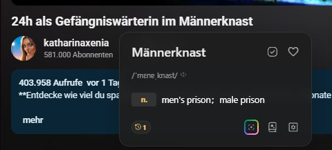

# trancy-noun-popup-on-youtube-title

**Site:** Trancy · **Group:** web-page-lookup

## What it shows

Word popup on ordinary page text (the YouTube video title): IPA with audio, POS, glosses, lookup count, mark known, save, AI, dictionary and settings buttons.

## Features I like

- Absolute must have for the extension to show translation of random words on the page on some action
- Design
