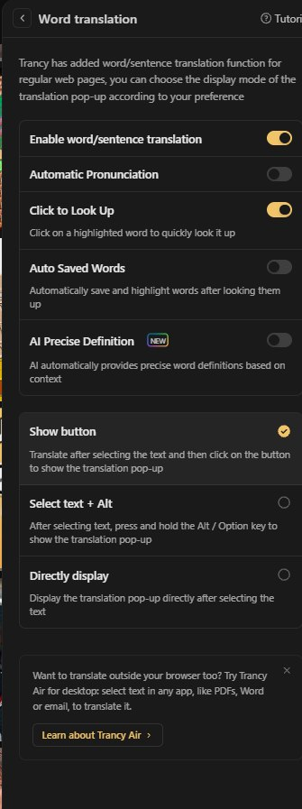

# trancy-web-page-translation-settings

**Site:** Trancy · **Group:** web-page-lookup

## What it shows

Word translation settings for regular web pages.

## Settings visible

- Enable word/sentence translation: on
- Automatic pronunciation: off
- Click to look up: on (click a highlighted word)
- Auto saved words: off (save and highlight words after looking them up)
- AI precise definition: off, new (definitions based on context)
- Trigger: Show button (selected; translate after selecting text and clicking the button) / Select text + Alt / Directly display
- Ad for Trancy Air (desktop app)

## Features I like

- Different triggers
