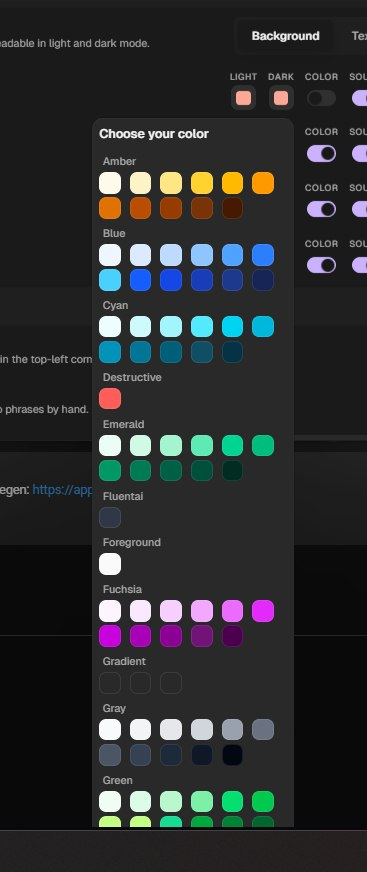

# fluentai-status-color-picker

**Site:** FluentAI · **Group:** word-coloring

## What it shows

Colour picker for a word status: palettes Amber, Blue, Cyan, Destructive, Emerald, FluentAI, Foreground, Fuchsia, Gradient, Gray, Green … with several shades each.

## Features I like

- Design

## Features I DONT like

- UX
