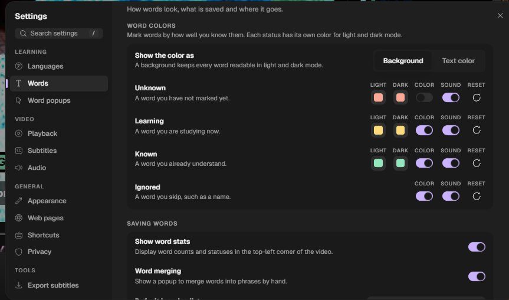

# fluentai-status-colors-and-word-stats

**Site:** FluentAI · **Group:** word-coloring

## What it shows

FluentAI settings, Words page: how words look, what is saved and where it goes.

## Settings visible

Word colors
- Show the color as: Background (selected) / Text color
- Unknown: light colour, dark colour, colour off, sound on, reset
- Learning: light colour, dark colour, colour on, sound on, reset
- Known: light colour, dark colour, colour on, sound on, reset
- Ignored: colour on, sound on, reset

Saving words
- Show word stats: on (word counts and statuses in the top-left corner of the video)
- Word merging: on (popup to merge words into phrases by hand)
- Default … list (cut off)

## Features I like

- Design
- Reset, different colors for each case and theme
- Background and word separation
- Toggles for color

## Features I dont care about 

- Show word stats
- Sound

-- Not sure what Word merging is