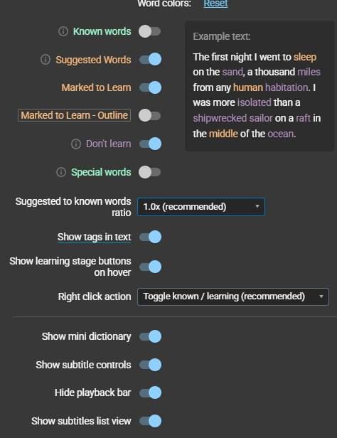

# languagereactor-word-color-and-display-settings

**Site:** Language Reactor · **Group:** word-coloring

## What it shows

Language Reactor display settings with a live example text.

## Settings visible

Word colors (Reset)
- Known words: off
- Suggested words: on
- Marked to Learn: on
- Marked to Learn – Outline: off
- Don't learn: on
- Special words: off
- Suggested to known words ratio: 1.0x (recommended)
- Show tags in text: on
- Show learning stage buttons on hover: on
- Right click action: Toggle known / learning (recommended)

Display
- Show mini dictionary: on
- Show subtitle controls: on
- Hide playback bar: on
- Show subtitles list view: on

## Features I like

- Suggested words

## Features I DONT like

- Design
- Outline
