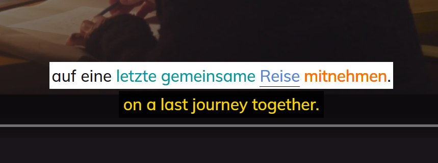

# lingopie-color-by-part-of-speech

**Site:** Lingopie · **Group:** word-coloring

## What it shows

Subtitle words coloured by part of speech (adjectives teal, noun blue and underlined as saved, verb orange); translation line below in yellow.

## Features I like

- Color by part of speach, altho I dont this it should be in the subtitles, it should be on special screen or grammar breakdown, altho its a good idea to add a toggle to use either PoS coloring or "word stage" coloring (the toggle is out of scope tho)
