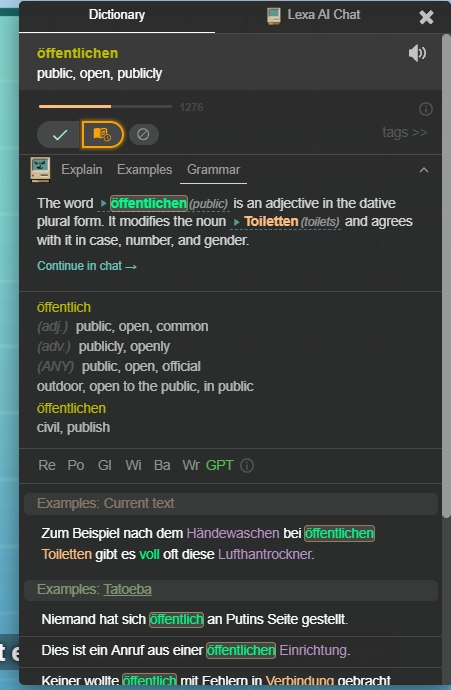

# languagereactor-dictionary-panel-ai-grammar-examples

**Site:** Language Reactor · **Group:** word-details

## What it shows

Dictionary panel for a word: translation, audio, frequency rank bar (1276), status buttons, tags; AI section with Explain / Examples / Grammar ("adjective in the dative plural form, modifies Toiletten …", Continue in chat); dictionary entries per POS; links to external dictionaries; examples from the current text and from Tatoeba. Tabs: Dictionary, Lexa AI Chat.

## Features I like

- Word stage toggle
- Word frequency

## Features I DONT like

- Design
- Messy data
