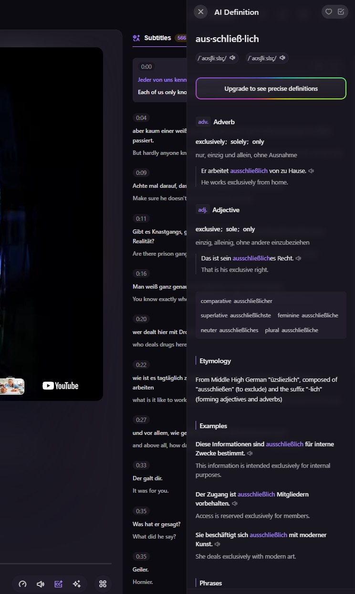

# trancy-ai-definition-ipa-forms

**Site:** Trancy · **Group:** word-details

## What it shows

AI Definition on Trancy's player: syllables (aus·schließ·lich), IPA, "Upgrade to see precise definitions", senses per POS with German definitions and examples, inflected forms (comparative, superlative, feminine, neuter, plural), etymology.

## Features I like

- Different meanings
- Ethymology

## Features I DONT like

- Separate examples, fills already limited space when there are already examples next to each meaning, if done should be a separate section that is clicked(like a tab)
