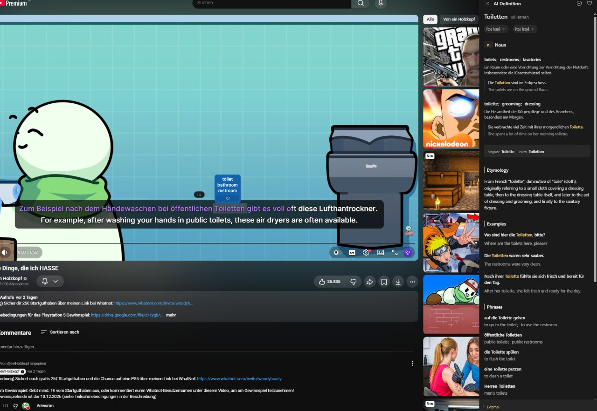

# trancy-ai-definition-on-youtube

**Site:** Trancy · **Group:** word-details

## What it shows

The same AI Definition sidebar opened on youtube.com after clicking a subtitle word; dual subtitles and hover popup visible in the YouTube player.

## Features I like

- Simple hover + detailed sidebar
- Phrases section

## Features I DONT like

- Design
- Separate examples, fills already limited space when there are already examples next to each meaning, if done should be a separate section that is clicked(like a tab)
