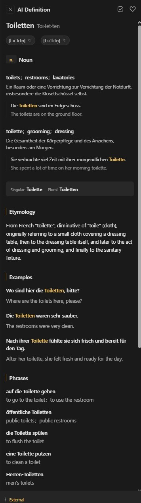

# trancy-ai-definition-senses-etymology-phrases

**Site:** Trancy · **Group:** word-details

## What it shows

AI Definition sidebar (extension): syllables, two IPA variants with audio, POS, senses with English glosses, a German definition and an example each, singular/plural, etymology, examples, phrases. Save and mark-known buttons; link to external dictionaries.

## Features I like

- Simple hover + detailed sidebar
- Phrases section

## Features I DONT like

- Separate examples, fills already limited space when there are already examples next to each meaning, if done should be a separate section that is clicked(like a tab)
