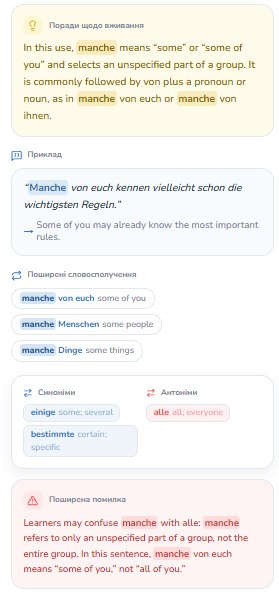

# tubevocab-collocations-synonyms-common-mistake

**Site:** TubeVocab · **Group:** word-details

## What it shows

Word analysis for "manche": usage tips, example, collocations, synonyms and antonyms, common mistake.

## Features I like

- I love the idea of "usual mistake" and "advice when using" when it makes sense, here is looks forced, as it its hardcoded to generate these sections for each word
- widely used phrases
- synonyms and antonyms
