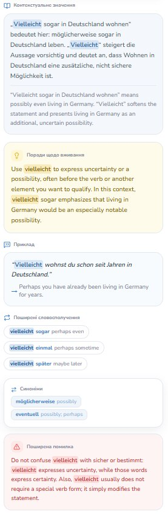

# tubevocab-contextual-meaning-usage-tips

**Site:** TubeVocab · **Group:** word-details

## What it shows

Word analysis for "vielleicht" (interface in Ukrainian): contextual meaning in German and English, usage tips, example, common collocations, synonyms, common mistake.

## Features I like

- I love the idea of "usual mistake" and "advice when using" when it makes sense, here is looks forced, as it its hardcoded to generate these sections for each word
- widely used phrases
- synonyms and antonyms
