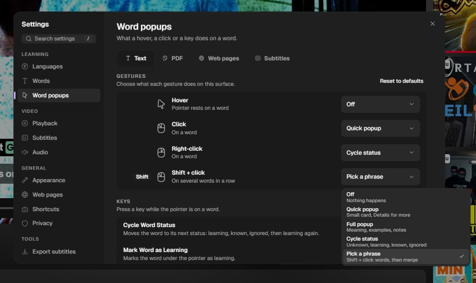

# fluentai-gesture-settings-hover-click-shift

**Site:** FluentAI · **Group:** word-popup

## What it shows

FluentAI settings, Word popups page: what a hover, click or key does on a word.

## Settings visible

Surfaces (tabs): Text, PDF, Web pages, Subtitles

Gestures
- Hover (pointer rests on a word): Off
- Click: Quick popup
- Right-click: Cycle status
- Shift + click (several words in a row): Pick a phrase
- Options for each: Off / Quick popup (small card, Details for more) / Full popup (meaning, examples, notes) / Cycle status (unknown, learning, known, ignored) / Pick a phrase (Shift + click words, then merge)
- Reset to defaults

Keys (pointer on a word)
- Cycle word status: learning → known → ignored → learning
- Mark word as learning

## Features I like

- Design
- Customisable actions
- Smart to combine word popup with website actions, in one place
