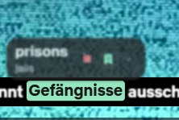

# fluentai-mini-popup-status-known

**Site:** FluentAI · **Group:** word-popup

## What it shows

Mini popup above a subtitle word with its translation and status buttons; the word is coloured as known (green).

## Features I like

- Design, colors
- Blur animation on appear
