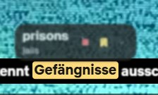

# fluentai-mini-popup-status-learning

**Site:** FluentAI · **Group:** word-popup

## What it shows

Same mini popup with the word marked as learning (yellow).

## Features I like

- Design, colors
- Blur animation on appear
