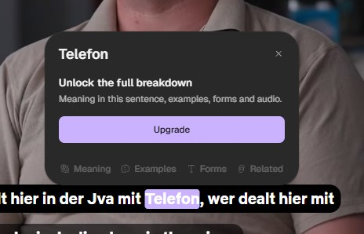

# fluentai-popup-tabs-meaning-examples-forms

**Site:** FluentAI · **Group:** word-popup

## What it shows

Word popup on a subtitle word, paid: "Unlock the full breakdown". Tabs: Meaning, Examples, Forms, Related.

## Features I like

- Design
- Unfortunately didnt have the subscription to see the contents
