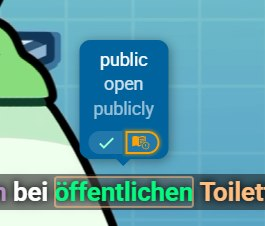

# languagereactor-click-popup-glosses-status

**Site:** Language Reactor · **Group:** word-popup

## What it shows

Click popup on a subtitle word: list of glosses (public, open, publicly) and status buttons (known, learning).

## Features I like

- Right click on word changes stage (it cycles unknown -> learning -> known -> ignore -> unknown)

## Features I DONT like

- Design
