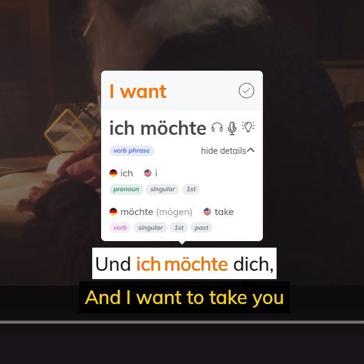

# lingopie-phrase-breakdown-lemma-features

**Site:** Lingopie · **Group:** word-popup

## What it shows

Expanded phrase popup: "ich möchte" as a verb phrase, then each word with its lemma, translation and features (ich: pronoun, singular, 1st; möchte (mögen): verb, singular, 1st, past).

## Features I like

- combining verb phrase

-- To be decided on the contents, there are many different approaches

