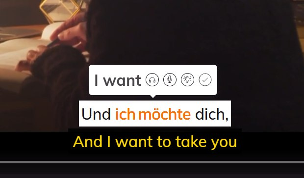

# lingopie-phrase-popup-listen-speak-explain

**Site:** Lingopie · **Group:** word-popup

## What it shows

Phrase popup for "ich möchte" → "I want", with listen, speak (mic), explain and mark-known icons.

## Features I like

- Simple
