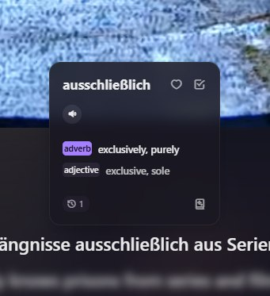

# trancy-click-popup-pos-glosses

**Site:** Trancy · **Group:** word-popup

## What it shows

Click popup: glosses grouped by part of speech (adverb, adjective), audio, save (heart), mark known, lookup count, open dictionary.

## Features I like

- Design kinda

## Features I DONT like

- Word is not highlighted on click
