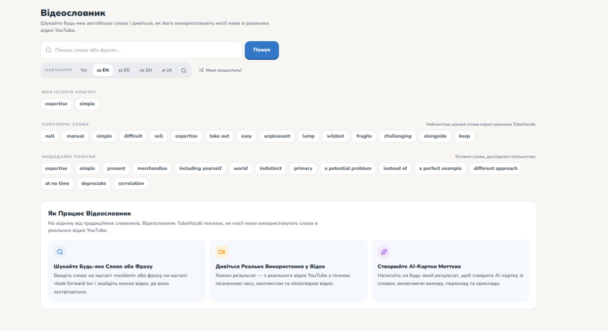

# tubevocab-video-dictionary-search

**Site:** TubeVocab · **Group:** word-search-in-videos

## What it shows

"Video dictionary" start page: search any word or phrase and see how native speakers use it in YouTube videos. Language chips (all, EN, ES, ZH, JA), "I'm feeling lucky", your search history, popular words, recent community searches, three-step explanation (search, watch real usage, create AI cards).

## Features I like

- Amazing feature, global index search

-- Not sure how its done
