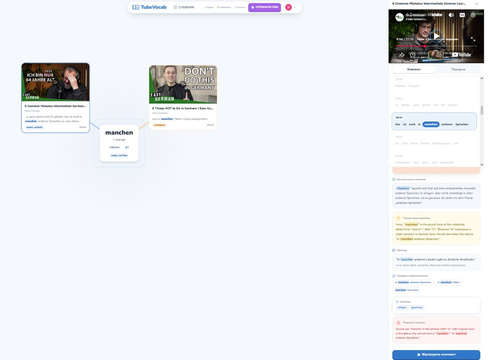

# tubevocab-word-graph-play-context

**Site:** TubeVocab · **Group:** word-search-in-videos

## What it shows

Word graph with a video selected: side panel plays the video at that moment, shows the transcript around it with the word highlighted, contextual analysis and "Play context".

## Features I like

- Amazing feature but needs an effort estimate
- Saving words in dictionary separate and connections to the videos as well is just great
