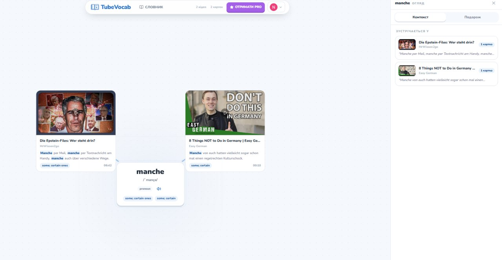

# tubevocab-word-graph-videos

**Site:** TubeVocab · **Group:** word-search-in-videos

## What it shows

Word graph: the word "manche" in the centre (IPA, POS, glosses) linked to the video cards it appears in; side panel lists where it occurs, with cards per video.

## Features I like

- Amazing feature but needs an effort estimate
- Saving words in dictionary separate and connections to the videos as well is just great
