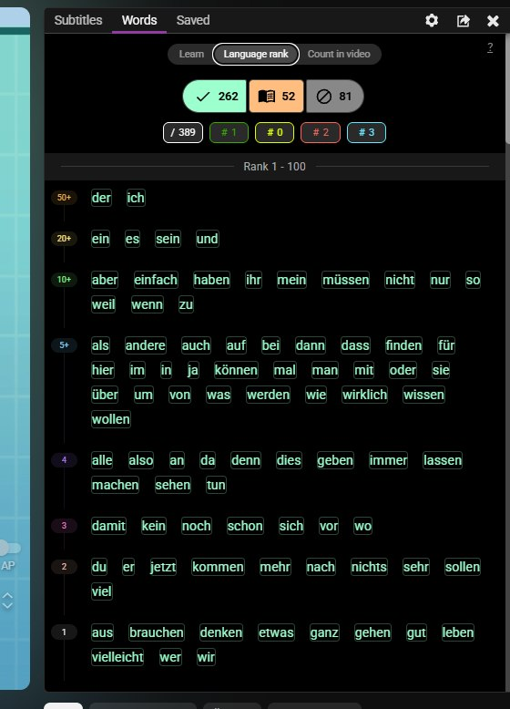

# languagereactor-words-by-count-and-status

**Site:** Language Reactor · **Group:** words-in-video

## What it shows

Words tab: all words of the video grouped by how often they occur (50+, 20+, 10+, 5+, 4, 3, 2, 1), coloured by status.

## Settings visible

- View: Learn / Language rank / Count in video
- Status totals: known 262, learning 52, ignored 81
- Tag filters: all 389, #1, #0, #2, #3

## Features I like

- Amazing feature, color coded words sorted by global frequency rank into bins and sorted by frequency occurance in the video within the bin

## Features I DONT like

- Design
