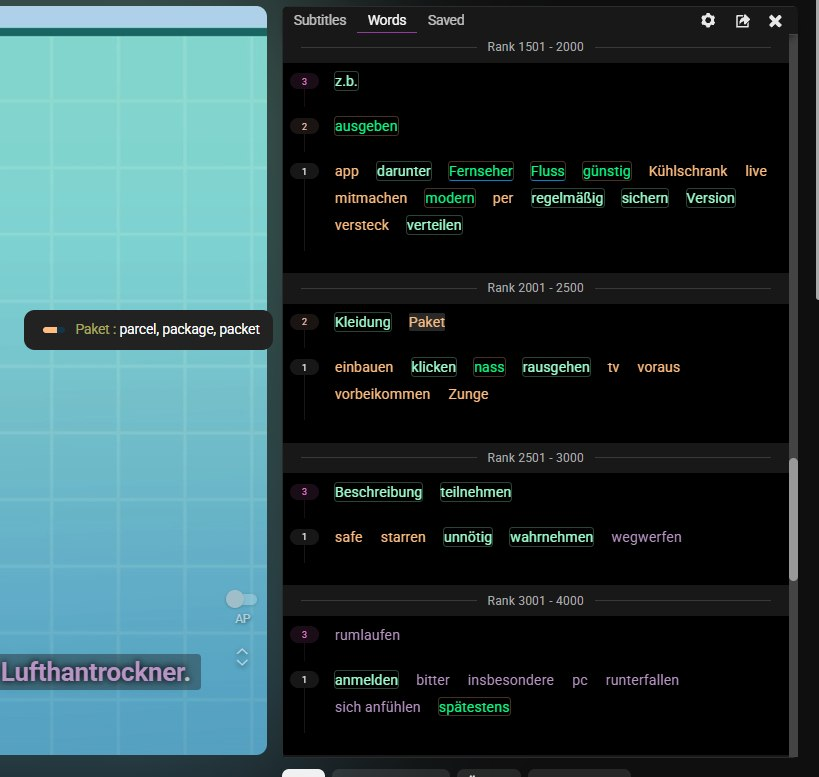

# languagereactor-words-by-frequency-rank

**Site:** Language Reactor · **Group:** words-in-video

## What it shows

Words tab in "Language rank" view: the video's words grouped by frequency band (1501–2000, 2001–2500 …) with occurrence counts, coloured by status, hover gloss.

## Features I like

- Color coded words
- Quick translation on hover

## Features I DONT like

- Design
