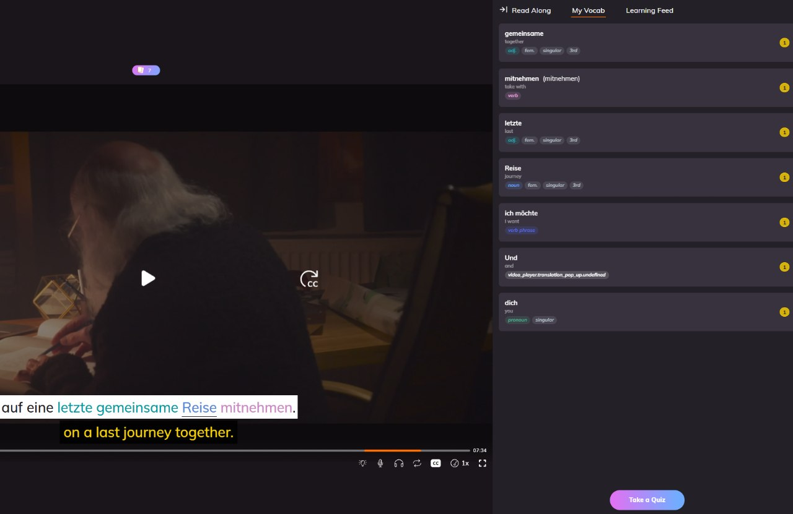

# lingopie-my-vocab-in-video-quiz

**Site:** Lingopie · **Group:** words-in-video

## What it shows

My Vocab tab: saved words from this video with gloss, grammar tags and SRS stage; "Take a Quiz" button. Subtitles coloured by part of speech.

## Features I like

- Separate word list of words that have been marked to learn specifically from this video (i.e. that have connection built)
- Kinda like the badges

## Features I DONT like

- Translation is shown instantly, maybe worth adding "closed eye" icon or only show translation on hover
