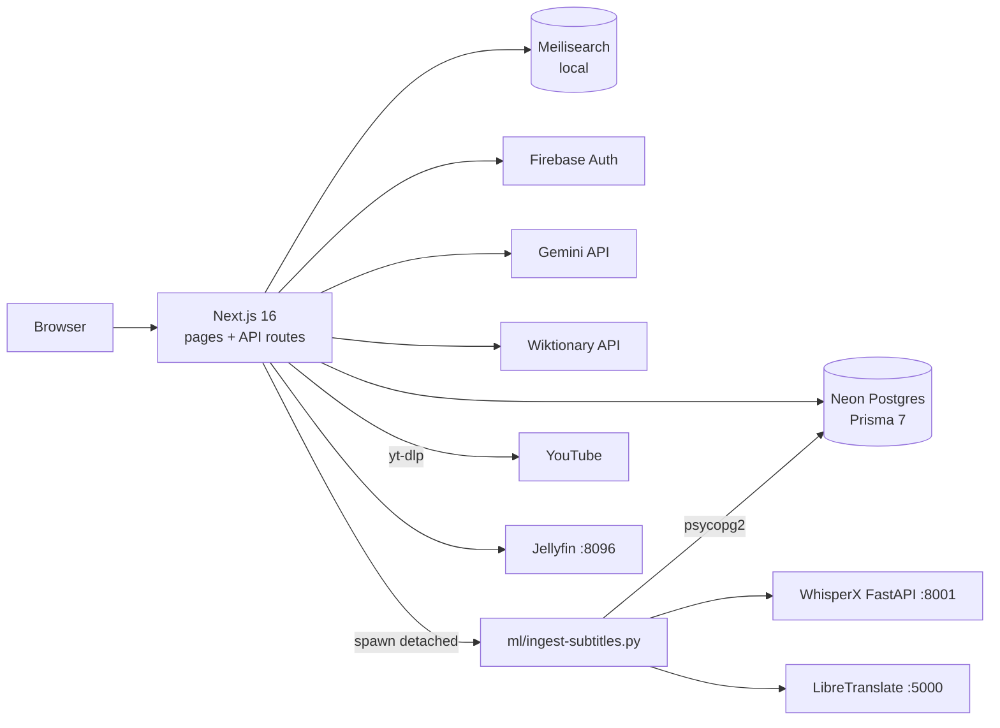

# Legacy architecture: overview

How the app works **today** (verified against the code at commit `5e043e7`, 2026-11-14). It describes what is in the repo, not what is planned: the plan is in `architecture-target/`. When a change lands, move what it changed out of the target file and update this one.

Everything runs on the developer's Mac.

**Stack:** Next.js 16 (App Router, mostly client components + TanStack Query), React 19, TypeScript, Tailwind 4 + shadcn/ui, Zustand, Zod, Prisma 7 with `@prisma/adapter-pg`, Neon Postgres, Firebase Auth (client SDK + Admin SDK, 14-day session cookie), Meilisearch, YouTube IFrame API, Plyr (Jellyfin only), Gemini, Wiktionary REST API.

Conventions that stay (request flow rules): `codebase-guide/conventions.md`.
