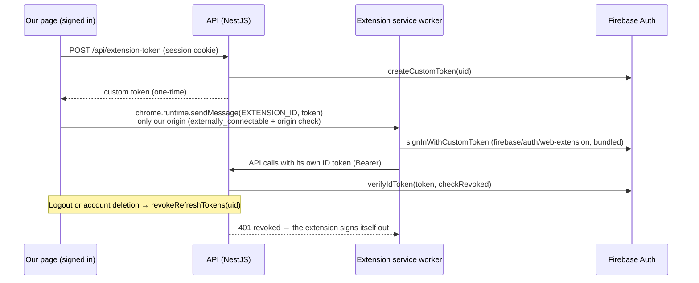

# Auth

**Since D-053:** one domain split by path (`/api/*` → NestJS, the rest → Next.js); both verify the Firebase session cookie through one shared check. The extension gets a short-lived custom token from our page, signs in to Firebase and sends ID tokens to NestJS.

- Web app: Firebase (Google sign-in or email + password) → existing httpOnly session cookie.
- Public pages don't load Firebase; the sign-in modal imports it dynamically (D-013).
- Extension (confirmed by spike 003, D-079):

  The extension ID is a constant set by the manifest `key`. The session survives service-worker restarts and browser restarts; the ID token refreshes itself.

Since D-038 the private instance has no public sign-up (accounts are created by hand) and the demo preferably has no login. The landing page and sign-in modal (D-013) therefore apply to the deferred public edition, or to the demo if it ever needs a login.
