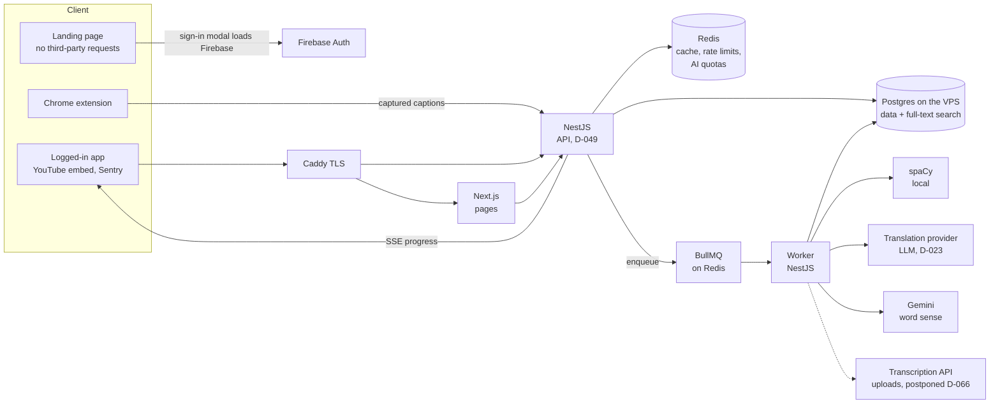

# Target architecture: overview

> **Provisional.** Architecture, features and scope are still being decided (see `open-questions.md`). This file records the current best design and is rewritten as decisions are made. Anything marked *open* is undecided, not planned.

> **Deployments (D-038, 2026-11-16).** What follows describes the **private instance** (server-side storage, friends only). A separate **read-only demo** runs the same code against its own database of rights-cleared content. The public edition (browser storage) is deferred; keep storage and search behind interfaces so it can be added. Public-page elements in this folder (landing page, sign-in modal, DSA form) now concern the demo or the deferred edition, not the private instance.

How the app is meant to work once the roadmap steps land. For how it works today, see `architecture-legacy/`.

One EU VPS running Docker Compose (D-006): Caddy, Next.js (pages), NestJS (API and worker, D-049), Redis (cache, quotas, BullMQ), Postgres (self-hosted, D-049). Server size chosen after measuring the load (Q-30). Deployed by GitHub Actions; backups as in `architecture-target/backups-and-deletion.md` (D-051).

